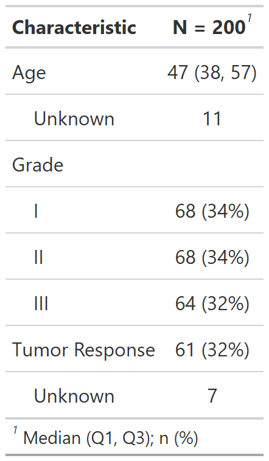
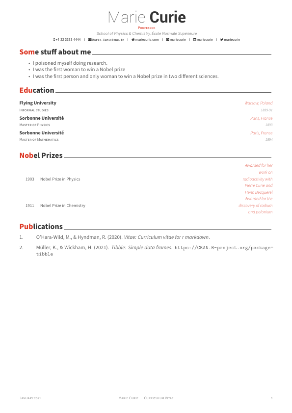
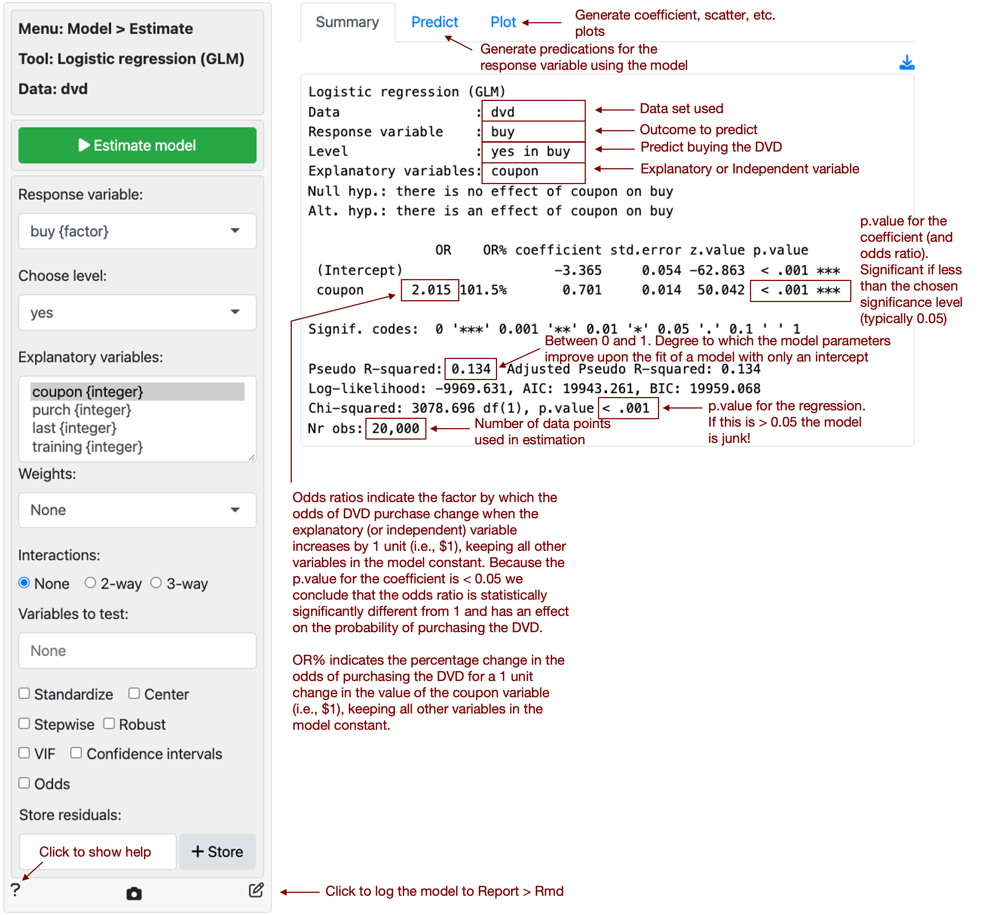
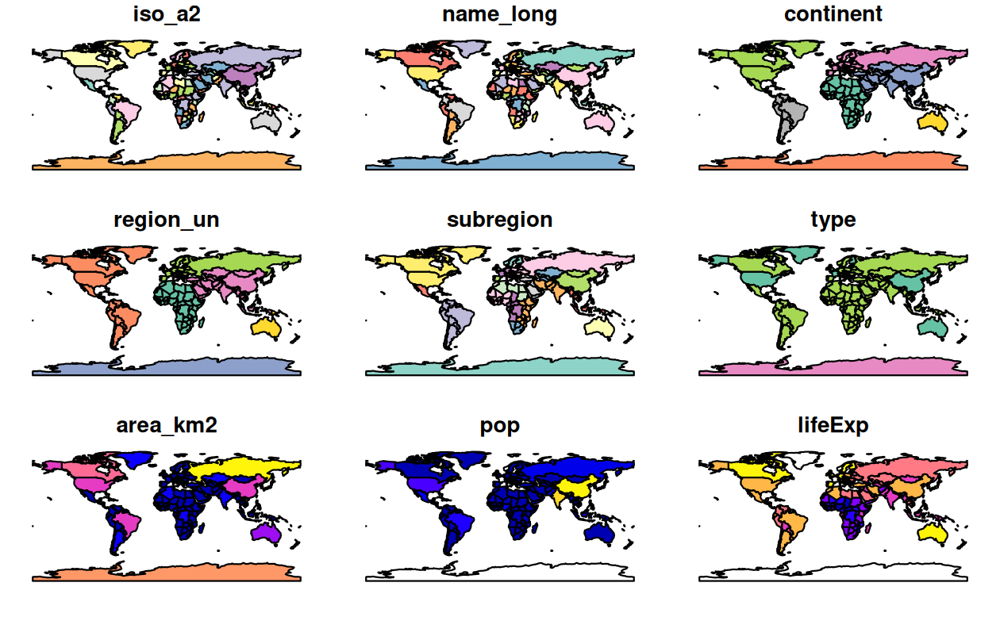

# 《HelloR》第 001 期｜拖拽作图、动画和论文 Table 1

你好，欢迎来到 **HelloR**。

我是公众号「**R语言与可视化**」。每周一我会在这里挑几条 GitHub 上有趣、入门能跑的 R 仓库，希望帮你更快摸到 R 的乐趣。

本期对应 **2026-W44**（2026-10-28）。每条都带配图和可点链接。

## 目录

- [可视化](#可视化)
- [表格与报告](#表格与报告)
- [统计与建模](#统计与建模)
- [交互 / Shiny](#交互--shiny)
- [实战案例](#实战案例)
- [开源书](#开源书)

## 内容

> **以下为本期内容**｜优先挑「克隆就能跑、作业/论文能直接用」的仓库

### 可视化

1、[esquisse](https://github.com/dreamRs/esquisse)：拖拽就能出 ggplot。这是 RStudio / Positron 里的可视化插件，用鼠标选变量、图表类型和配色，背后自动生成可复制的 `ggplot2` 代码。适合刚学作图、想先「看见结果再回头改代码」的同学。

[仓库](https://github.com/dreamRs/esquisse) · [文档](https://dreamrs.github.io/esquisse)

2、[gganimate](https://github.com/thomasp85/gganimate)：让静态图动起来。在 `ggplot2` 语法上加几行，就能把时间、组别做成帧动画，导出 GIF 或视频。课堂演示、公众号封面动效都很常用。

[仓库](https://github.com/thomasp85/gganimate) · [文档](https://gganimate.com/)

3、[tidyplots](https://github.com/jbengler/tidyplots)：少写样板，直接出期刊常见图。管道式 API 可快速做出点图、箱线图、均值误差棒等科研里常见的图型，适合写论文、交作业时先出图再微调。

[仓库](https://github.com/jbengler/tidyplots) · [文档](https://jbengler.github.io/tidyplots/)

4、[ggalign](https://github.com/Yunuuuu/ggalign)：把多张 ggplot 对齐成复杂拼图。可组合热图、树状图、Upset 等，适合生信/医学里常见的「一页多面板」排版，文档和示例都比较全。

[仓库](https://github.com/Yunuuuu/ggalign) · [文档](https://yunuuuu.github.io/ggalign/)

5、[r-color-palettes](https://github.com/EmilHvitfeldt/r-color-palettes)：R 配色大全。一张清单汇总多个 R 包里的调色板，挑期刊友好或课堂演示用的配色时很省事。

[仓库](https://github.com/EmilHvitfeldt/r-color-palettes)

6、[patchwork](https://github.com/thomasp85/patchwork)：像拼乐高一样拼图。用 `+`、`|`、`/` 把多张 `ggplot` 合成一页，控制比例和标签，比手调 `par`/`grid` 轻松很多。

[仓库](https://github.com/thomasp85/patchwork) · [文档](https://patchwork.data-imaginist.com/)

### 表格与报告

7、[gtsummary](https://github.com/ddsjoberg/gtsummary)：几行代码做出论文 Table 1。从数据框直接生成基线特征表、回归结果表，支持分层、脚注和多种输出格式，医学统计作业与论文里很对口。

[仓库](https://github.com/ddsjoberg/gtsummary) · [文档](https://www.danieldsjoberg.com/gtsummary/)

8、[vitae](https://github.com/mitchelloharawild/vitae)：用 R Markdown 写简历。经历写在文档里，可导出 PDF/HTML；改内容不用手工重排版。

[仓库](https://github.com/mitchelloharawild/vitae) · [文档](https://pkg.mitchelloharawild.com/vitae/)

### 统计与建模

9、[easystats](https://github.com/easystats/easystats)：模型检查与解读工具箱。装好后可用 `performance`、`parameters`、`see` 等包检查拟合、提取系数、画诊断图，比直接读 `summary()` 更易上手。

[仓库](https://github.com/easystats/easystats) · [文档](https://easystats.github.io/easystats/)

### 交互 / Shiny

10、[radiant](https://github.com/radiant-rstats/radiant)：点选菜单完成数据分析。基于 Shiny 的菜单式应用，覆盖描述统计、抽样、回归与多元方法；适合课堂演示「不写代码也能走完分析流程」。

[仓库](https://github.com/radiant-rstats/radiant) · [文档](https://radiant-rstats.github.io/docs/)

11、[rhino](https://github.com/Appsilon/rhino)：可维护的 Shiny 项目脚手架。按模块、测试和 JS/Sass 管线搭应用，做仪表盘或作品集时比从零堆一个 `app.R` 更稳妥。

[仓库](https://github.com/Appsilon/rhino) · [文档](https://appsilon.github.io/rhino)

### 实战案例

12、[ggplot2-20-journal-cases](https://github.com/GeneticistHere/ggplot2-20-journal-cases)：20 种顶刊常见图型，用模拟数据复刻。曼哈顿、火山、Sankey、雨云图、游泳图等各有独立 `simulate.R` + `plot.R`，克隆即可跑，医学/生信读者可直接对照改自己的数据。

[仓库](https://github.com/GeneticistHere/ggplot2-20-journal-cases)

### 开源书

13、[geocompr](https://github.com/geocompx/geocompr)：《Geocomputation with R》。开源地理计算教材，从矢量栅格到制图与建模，配套代码可跟练，想做地图可视化或空间分析时当主线教材很合适。

[仓库](https://github.com/geocompx/geocompr) · [在线书](https://r.geocompx.org/)

---

**下期预告**：继续找「有趣 + 入门能跑」的仓库；欢迎自荐（需自带可预览图或官网截图）。

欢迎关注公众号「**R语言与可视化**」，订阅后每周一就能收到新一期 HelloR。我们下期见。

『本期完』
