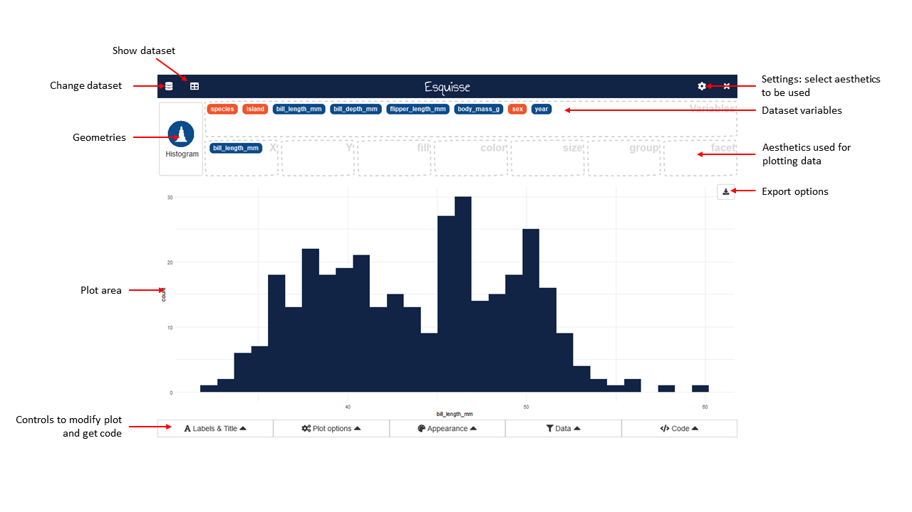
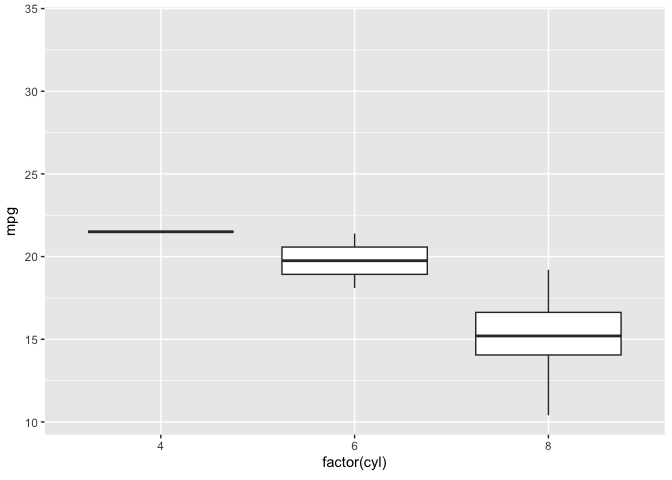
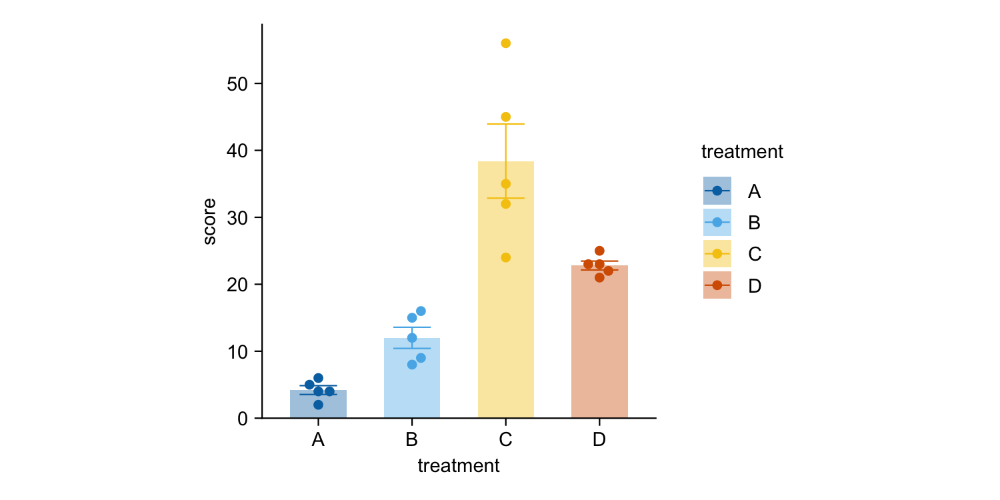
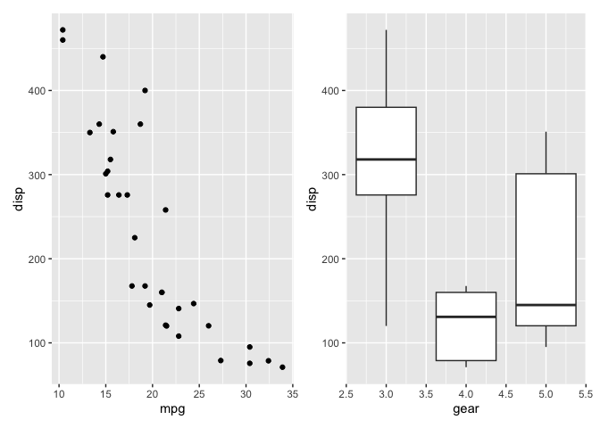
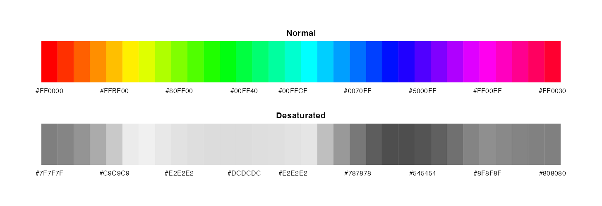

# HelloR 第001期｜拖拽作图与动画

你好，欢迎来到 **HelloR**。

我是公众号「**R语言与可视化**」。每周一我会在这里分享实用的 R 语言包、教程、博文等，记得收藏，用到的时候再翻看。

## 目录

- [可视化](#可视化)

## 内容

### 可视化

1、[esquisse](https://github.com/dreamRs/esquisse)：拖拽就能出 ggplot。这是 RStudio / Positron 里的可视化插件，用鼠标选变量、图表类型和配色，背后自动生成可复制的 `ggplot2` 代码。适合刚学作图、想先「看见结果再回头改代码」的同学。

[仓库](https://github.com/dreamRs/esquisse) · [文档](https://dreamrs.github.io/esquisse)

2、[gganimate](https://github.com/thomasp85/gganimate)：让静态图动起来。在 `ggplot2` 语法上加几行，就能把时间、组别做成帧动画，导出 GIF 或视频。课堂演示、公众号封面动效都很常用。

[仓库](https://github.com/thomasp85/gganimate) · [文档](https://gganimate.com/)

3、[tidyplots](https://github.com/jbengler/tidyplots)：少写样板，直接出期刊常见图。管道式 API 可快速做出点图、箱线图、均值误差棒等科研里常见的图型，适合写论文、交作业时先出图再微调。

[仓库](https://github.com/jbengler/tidyplots) · [文档](https://jbengler.github.io/tidyplots/)

4、[patchwork](https://github.com/thomasp85/patchwork)：像拼乐高一样拼图。用 `+`、`|`、`/` 把多张 `ggplot` 合成一页，控制比例和标签，比手调 `par`/`grid` 轻松很多。

[仓库](https://github.com/thomasp85/patchwork) · [文档](https://patchwork.data-imaginist.com/)

5、[r-color-palettes](https://github.com/EmilHvitfeldt/r-color-palettes)：R 配色大全。一张清单汇总多个 R 包里的调色板，挑期刊友好或课堂演示用的配色时很省事。

[仓库](https://github.com/EmilHvitfeldt/r-color-palettes)

---

**下期预告**：HelloR 第002期｜Table1与模型检查——gtsummary、vitae、easystats、ggalign。

欢迎关注公众号「**R语言与可视化**」，订阅后每周一就能收到新一期 HelloR。我们下期见。
