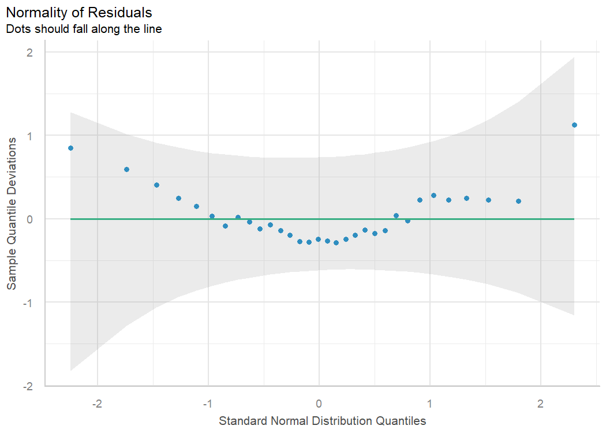
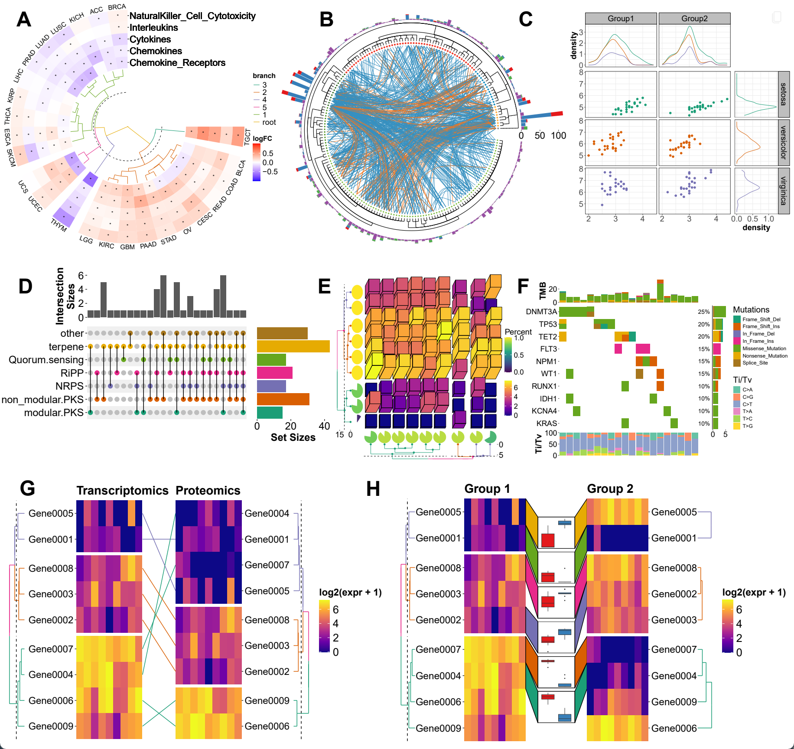

# HelloR 第002期｜Table1与模型检查

你好，欢迎来到 **HelloR**。

我是公众号「**R语言与可视化**」。每周一我会在这里分享实用的 R 语言包、教程、博文等，记得收藏，用到的时候再翻看。

## 目录

- [表格与报告](#表格与报告)
- [统计与建模](#统计与建模)
- [可视化](#可视化)

## 内容

### 表格与报告

1、[gtsummary](https://github.com/ddsjoberg/gtsummary)：几行代码做出论文 Table 1。从数据框直接生成基线特征表、回归结果表，支持分层、脚注和多种输出格式，医学统计作业与论文里很对口。

[仓库](https://github.com/ddsjoberg/gtsummary) · [文档](https://www.danieldsjoberg.com/gtsummary/)

2、[vitae](https://github.com/mitchelloharawild/vitae)：用 R Markdown 写简历。经历写在文档里，可导出 PDF/HTML；改内容不用手工重排版。

[仓库](https://github.com/mitchelloharawild/vitae) · [文档](https://pkg.mitchelloharawild.com/vitae/)

### 统计与建模

3、[easystats](https://github.com/easystats/easystats)：模型检查与解读工具箱。装好后可用 `performance`、`parameters`、`see` 等包检查拟合、提取系数、画诊断图，比直接读 `summary()` 更易上手。

[仓库](https://github.com/easystats/easystats) · [文档](https://easystats.github.io/easystats/)

### 可视化

4、[ggalign](https://github.com/Yunuuuu/ggalign)：把多张 ggplot 对齐成复杂拼图。可组合热图、树状图、Upset 等，适合生信/医学里常见的「一页多面板」排版，文档和示例都比较全。

[仓库](https://github.com/Yunuuuu/ggalign) · [文档](https://yunuuuu.github.io/ggalign/)

---

**下期预告**：HelloR 第003期｜Shiny与地图实战——radiant、rhino、ggplot2 顶刊复刻与 geocompr。

欢迎关注公众号「**R语言与可视化**」，订阅后每周一就能收到新一期 HelloR。我们下期见。
