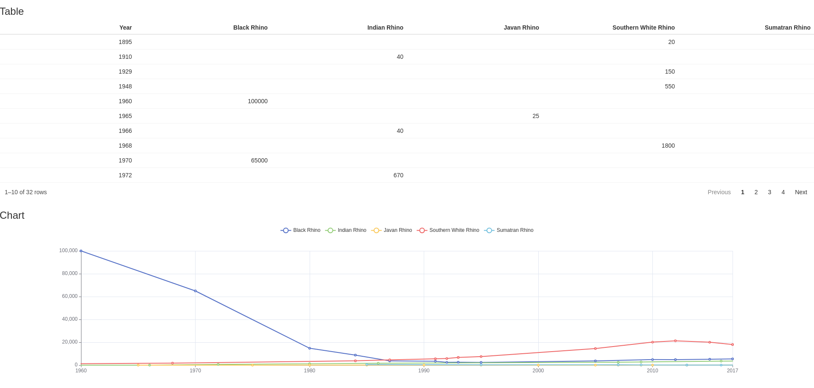
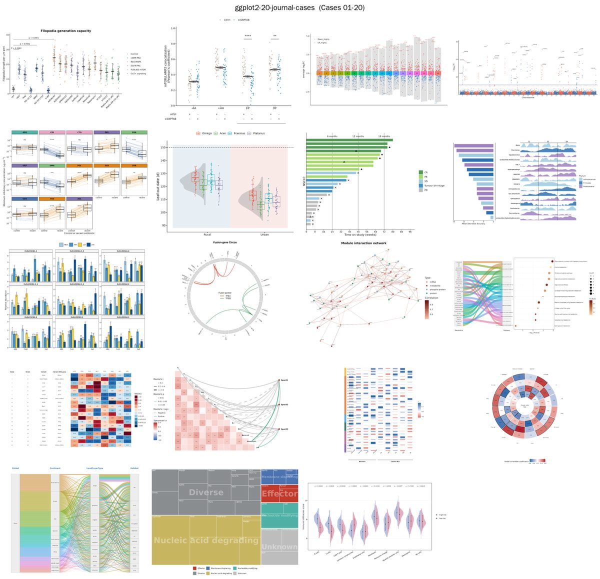

# HelloR 第003期｜Shiny与地图实战

你好，欢迎来到 **HelloR**。

我是公众号「**R语言与可视化**」。每周一我会在这里分享实用的 R 语言包、教程、博文等，记得收藏，用到的时候再翻看。

## 目录

- [交互 / Shiny](#交互--shiny)
- [实战案例](#实战案例)
- [开源书](#开源书)

## 内容

### 交互 / Shiny

1、[radiant](https://github.com/radiant-rstats/radiant)：点选菜单完成数据分析。基于 Shiny 的菜单式应用，覆盖描述统计、抽样、回归与多元方法；适合课堂演示「不写代码也能走完分析流程」。

[仓库](https://github.com/radiant-rstats/radiant) · [文档](https://radiant-rstats.github.io/docs/)

2、[rhino](https://github.com/Appsilon/rhino)：可维护的 Shiny 项目脚手架。按模块、测试和 JS/Sass 管线搭应用，做仪表盘或作品集时比从零堆一个 `app.R` 更稳妥。

[仓库](https://github.com/Appsilon/rhino) · [文档](https://appsilon.github.io/rhino)

### 实战案例

3、[ggplot2-20-journal-cases](https://github.com/GeneticistHere/ggplot2-20-journal-cases)：20 种顶刊常见图型，用模拟数据复刻。曼哈顿、火山、Sankey、雨云图、游泳图等各有独立 `simulate.R` + `plot.R`，克隆即可跑，医学/生信读者可直接对照改自己的数据。

[仓库](https://github.com/GeneticistHere/ggplot2-20-journal-cases)

### 开源书

4、[geocompr](https://github.com/geocompx/geocompr)：《Geocomputation with R》。开源地理计算教材，从矢量栅格到制图与建模，配套代码可跟练，想做地图可视化或空间分析时当主线教材很合适。

[仓库](https://github.com/geocompx/geocompr) · [在线书](https://r.geocompx.org/)

---

**下期预告**：继续分享实用的 R 语言包、教程、博文；欢迎自荐（需自带可预览图或官网截图）。

欢迎关注公众号「**R语言与可视化**」，订阅后每周一就能收到新一期 HelloR。我们下期见。
