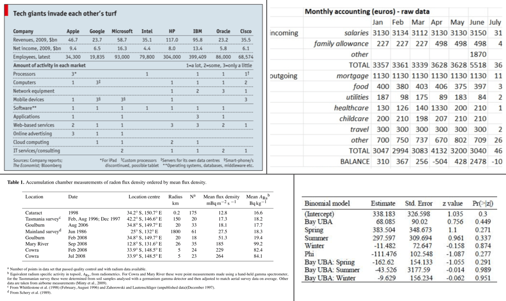
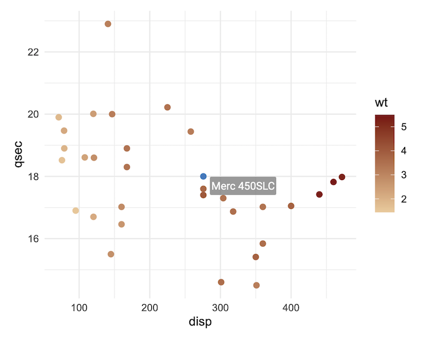
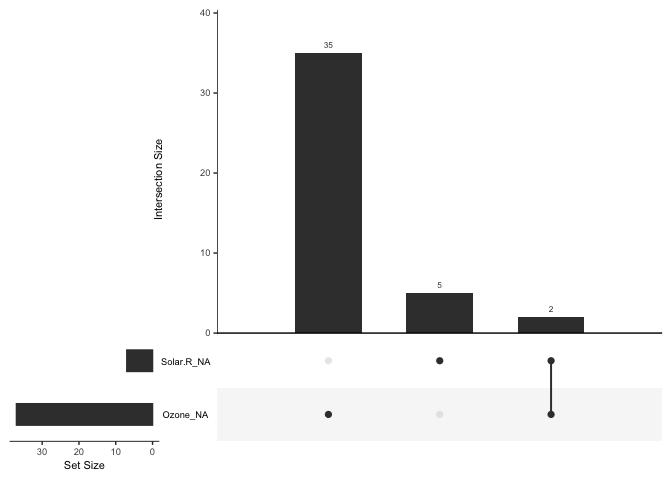
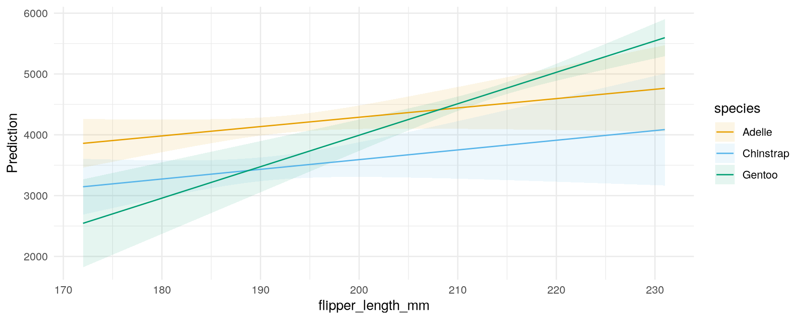
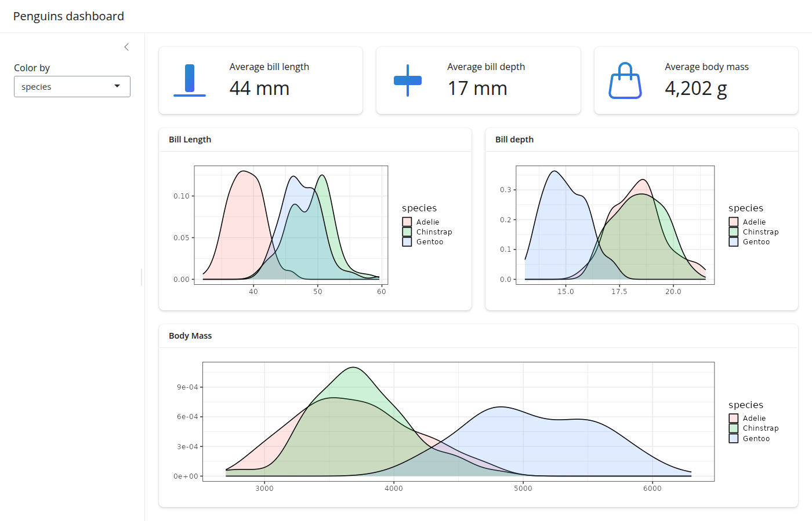

# HelloR 第004期｜表格、缺测与Shiny主题

你好，欢迎来到 **HelloR**。

我是公众号「**R语言与可视化**」。每期我会在这里分享实用的 R 语言包、教程、博文等，记得收藏，用到的时候再翻看。

## 目录

- [表格与报告](#表格与报告)
- [可视化](#可视化)
- [统计与建模](#统计与建模)
- [交互 / Shiny](#交互--shiny)

## 内容

### 表格与报告

1、[gt](https://github.com/rstudio/gt)：用「表格语法」做出刊级表格。把表头、stub、脚注、数字格式当成可组合的部件，写出论文、报告里常见的展示表；支持 HTML / LaTeX / RTF 等输出。

[仓库](https://github.com/rstudio/gt) · [文档](https://gt.rstudio.com/)

### 可视化

2、[ggiraph](https://github.com/davidgohel/ggiraph)：让 ggplot 可点击、可悬停。在熟悉的 `ggplot2` 语法上加交互图层，导出 HTML 后可悬停看标签、点选高亮，课堂演示和网页报告里比静态图更好讲。

[仓库](https://github.com/davidgohel/ggiraph) · [文档](https://davidgohel.github.io/ggiraph/)

3、[naniar](https://github.com/njtierney/naniar)：把缺测画出来再动手。提供 `vis_miss`、`gg_miss_var`、`geom_miss_point` 等图，先看清缺在哪些变量、哪些组合，再决定删、填或建模；医学问卷和临床数据里很实用。

[仓库](https://github.com/njtierney/naniar) · [文档](https://naniar.njtierney.com/)

### 统计与建模

4、[marginaleffects](https://github.com/vincentarelbundock/marginaleffects)：把模型结果说成人话。统一接口算预测值、对比和斜率，并直接画出条件效应图；适合回归课后「系数看不懂、想看边际变化」的场景。

[仓库](https://github.com/vincentarelbundock/marginaleffects) · [文档](https://marginaleffects.com/)

### 交互 / Shiny

5、[bslib](https://github.com/rstudio/bslib)：给 Shiny 换上现代 Bootstrap 主题。用 `page_sidebar`、卡片和 value box 搭仪表盘，还能实时调色、换 Bootswatch；做课程作业或作品集界面时比默认灰白清爽很多。

[仓库](https://github.com/rstudio/bslib) · [文档](https://rstudio.github.io/bslib/)

---

**下期预告**：继续分享实用的 R 语言包、教程、博文；欢迎自荐（需自带可预览图或官网截图）。

欢迎关注公众号「**R语言与可视化**」，订阅后每期都能收到新一期 HelloR。我们下期见。
