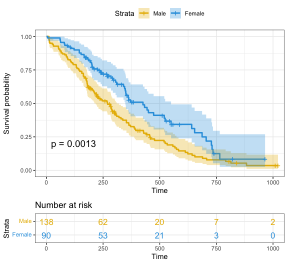
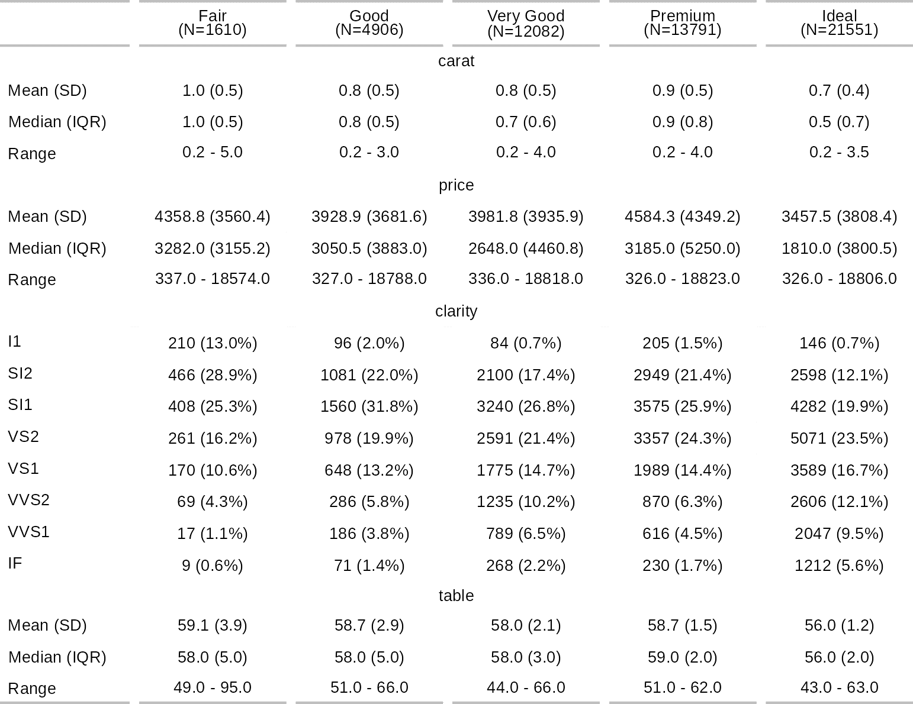
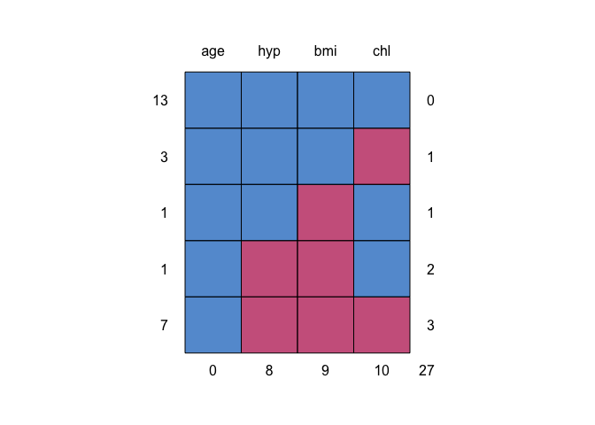
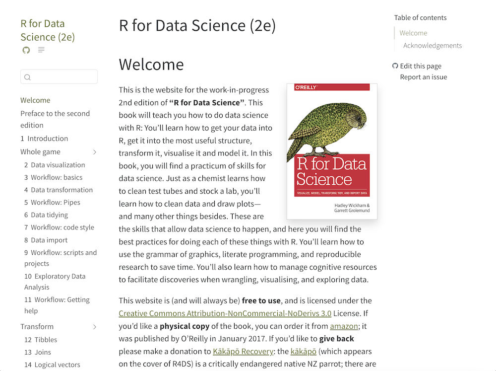

# HelloR 第005期｜生存曲线、填补与中文作图

你好，欢迎来到 **HelloR**。

我是公众号「**R语言与可视化**」。每期我会在这里分享实用的 R 语言包、教程、博文等，记得收藏，用到的时候再翻看。

## 目录

- [可视化](#可视化)
- [表格与报告](#表格与报告)
- [统计与建模](#统计与建模)
- [开源书](#开源书)

## 内容

### 可视化

1、[survminer](https://github.com/kassambara/survminer)：几行代码画出带风险表的生存曲线。用 `ggsurvplot()` 在 Kaplan-Meier 曲线下配上 number-at-risk 表，还可以加置信带、log-rank p 值和中位生存线。数据先交给 `survival` 包的 `survfit()`，再接到这里，医学随访里常见的 KM 图就能画出来。

[仓库](https://github.com/kassambara/survminer) · [文档](https://rpkgs.datanovia.com/survminer/)

2、[showtext](https://github.com/yixuan/showtext)：让图里的中文不再变成方块。它把字体轮廓画进图中，别人打开时不必安装同一款字体；自带文泉驿微米黑（`wqy-microhei`），也可以加载思源黑体、思源宋体或 Google Fonts。写中文标题和坐标轴时，先调用 `showtext_auto()` 再作图即可。

[仓库](https://github.com/yixuan/showtext) · [文档](https://cran.r-project.org/web/packages/showtext/vignettes/introduction.html)

### 表格与报告

3、[flextable](https://github.com/davidgohel/flextable)：做出能直接放进 Word 和 PPT 的表。用 `bold()`、`color()`、`highlight()` 这些动词控制单元格，也可用 `as_flextable()` 把汇总结果转成表；配合 officer 写出 docx/pptx，交作业和投稿时比先截图再粘贴更稳妥。

[仓库](https://github.com/davidgohel/flextable) · [文档](https://davidgohel.github.io/flextable/)

### 统计与建模

4、[mice](https://github.com/amices/mice)：用多重插补填上缺失值。先 `md.pattern()` 看清缺在哪些变量组合，再用链式方程做多次填补，最后用 `with()` 和 `pool()` 合并分析结果，标准误会把填补带来的不确定性算进去。问卷和临床数据里，比直接删行或用均值填上更稳妥。

[仓库](https://github.com/amices/mice) · [文档](https://amices.org/mice/)

### 开源书

5、[r4ds](https://github.com/hadley/r4ds)：《R for Data Science》第二版。从导入、整理到作图的免费教材，内容覆盖可视化、数据变换、变长变宽和导入，后面补上脚本工作流，沟通部分改用 Quarto。在线阅读完全免费，适合当作数据分析入门的主线教材跟着敲。

[仓库](https://github.com/hadley/r4ds) · [在线书](https://r4ds.hadley.nz/)

---

**下期预告**：继续分享实用的 R 语言包、教程、博文；欢迎自荐（需自带可预览图或官网截图）。

欢迎关注公众号「**R语言与可视化**」，订阅后每期都能收到新一期 HelloR。我们下期见。
