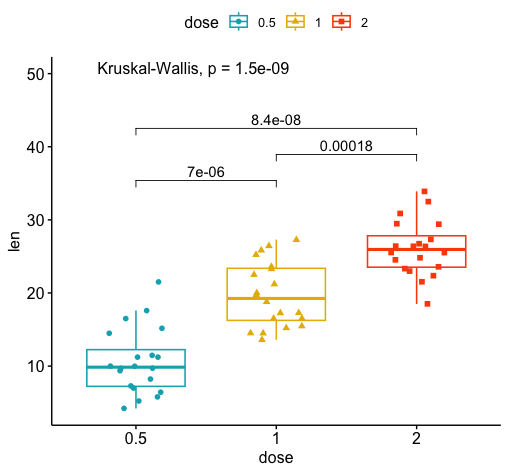
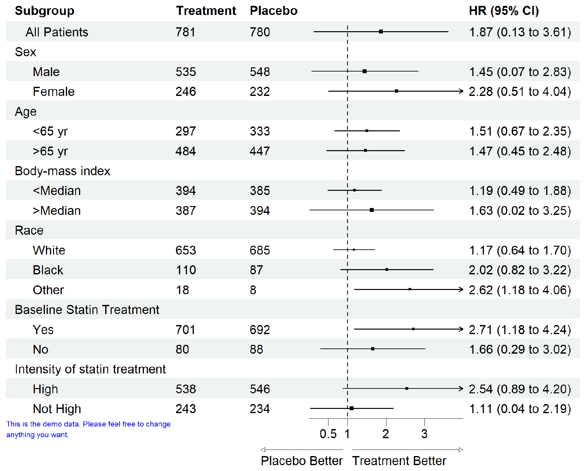
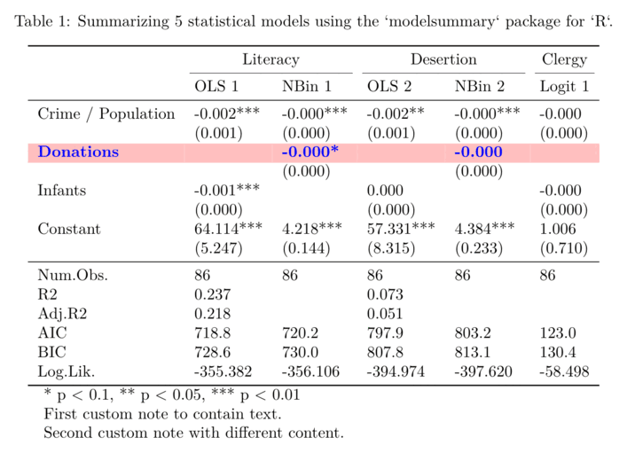
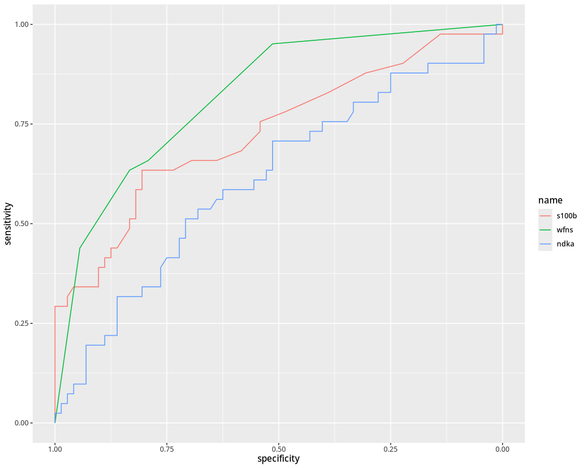
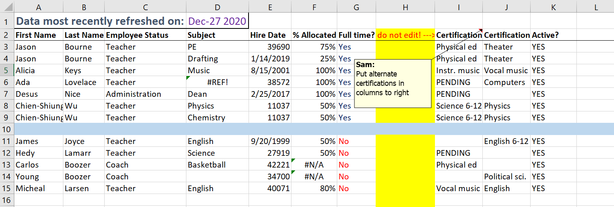

# HelloR 第006期｜出版图、ROC与数据清理

你好，欢迎来到 **HelloR**。

我是公众号「**R语言与可视化**」。每期我会在这里分享实用的 R 语言包、教程、博文等，记得收藏，用到的时候再翻看。

## 目录

- [可视化](#可视化)
- [表格与报告](#表格与报告)
- [统计与建模](#统计与建模)
- [实战案例](#实战案例)

## 内容

### 可视化

1、[ggpubr](https://github.com/kassambara/ggpubr)：几行代码画出带 P 值的出版图。用 `ggboxplot()`、`ggviolin()` 出图，再加 `stat_compare_means()`，就能在图上标出组间比较和总体检验的 P 值。医学论文里常见的箱线图、小提琴图，不必画完再手工贴星号。

[仓库](https://github.com/kassambara/ggpubr) · [文档](https://rpkgs.datanovia.com/ggpubr/)

2、[forestploter](https://github.com/adayim/forestploter)：按表格布局画出论文里的森林图。把亚组、例数和 HR（95% CI）放进数据框，用 `forest()` 画出置信区间，再用 `set_xaxis()`、`set_labs()` 加上参考线和箭头说明。做亚组分析，或把回归结果画成森林图时，比在 Word 里对齐线段省事。

[仓库](https://github.com/adayim/forestploter) · [文档](https://adayim.github.io/forestploter/)

### 表格与报告

3、[modelsummary](https://github.com/vincentarelbundock/modelsummary)：把多个模型并排做成结果表。一行 `modelsummary()` 就能对比回归系数、标准误和拟合指标，也可以用 `modelplot()` 画系数图；表能导出到 Word、LaTeX 和 HTML。写论文或作业时，不用把 `summary()` 的结果手工抄进表格。

[仓库](https://github.com/vincentarelbundock/modelsummary) · [文档](https://modelsummary.com/)

### 统计与建模

4、[pROC](https://github.com/xrobin/pROC)：用来画和分析 ROC 曲线。用 `roc()` 计算 AUC，`ci()` 给出置信区间，`roc.test()` 比较两条曲线（例如 DeLong 检验），也可以用 `ggroc()` 接到 ggplot2。诊断试验或评分模型要报告 AUC、比较不同指标时很常用。

[仓库](https://github.com/xrobin/pROC) · [文档](https://xrobin.github.io/pROC/)

### 实战案例

5、[janitor](https://github.com/sfirke/janitor)：把 Excel 脏表整理成能分析的数据。`clean_names()` 把乱七八糟的列名改成规则的变量名，`remove_empty()` 去掉空行空列，`convert_to_date()` 处理混在一起的日期格式；`tabyl()` 再配上一组 `adorn_()` 函数，还能快速做出带合计和百分比的频数表。问卷或临床表导入 R 之后，往往先过一遍这些函数。

[仓库](https://github.com/sfirke/janitor) · [文档](https://sfirke.github.io/janitor/)

---

**下期预告**：继续分享实用的 R 语言包、教程、博文；欢迎自荐（需自带可预览图或官网截图）。

欢迎关注公众号「**R语言与可视化**」，订阅后每期都能收到新一期 HelloR。我们下期见。
