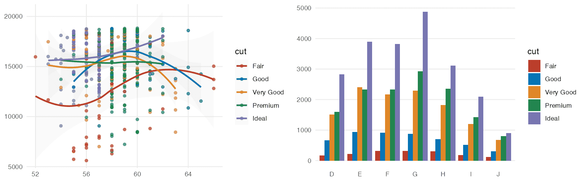
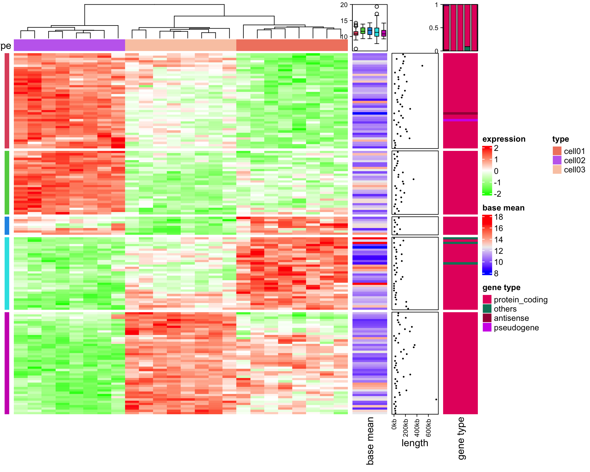
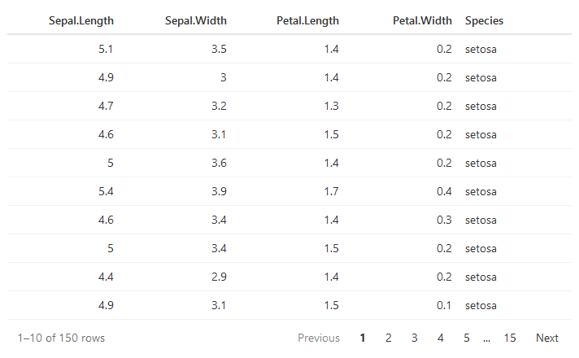
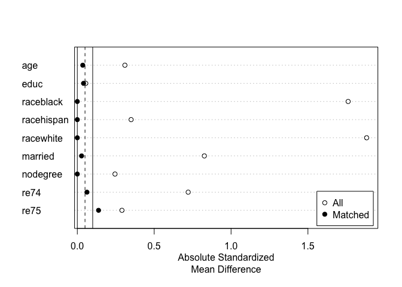
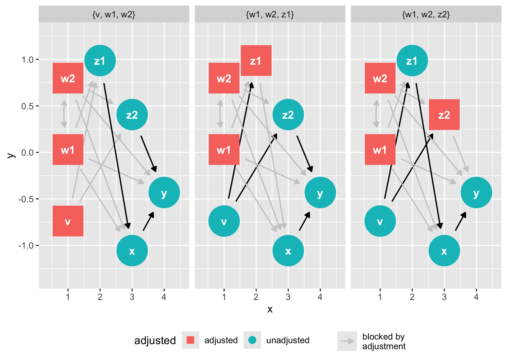

# HelloR 第007期｜期刊配色、热图与匹配

欢迎来到「**R语言与可视化**」的系列节目 **HelloR**。每期我会在这里分享实用的 R 语言包、教程、博文等，记得收藏，用到的时候再翻看。

## 目录

- [可视化](#可视化)
- [表格与报告](#表格与报告)
- [统计与建模](#统计与建模)

## 内容

### 可视化

1、[ggsci](https://github.com/nanxstats/ggsci)：把期刊配色接到 ggplot2 上。用 `scale_color_nejm()`、`scale_fill_lancet()`、`scale_color_npg()` 这类函数，就能换上《NEJM》《Lancet》《Nature》等期刊常用的配色；JAMA、BMJ、JCO 也有对应的标度。写论文配图时，不用自己从 PDF 里吸色。

[仓库](https://github.com/nanxstats/ggsci) · [文档](https://nanx.me/ggsci/)

2、[ComplexHeatmap](https://github.com/jokergoo/ComplexHeatmap)：把热图、注释和分割排在同一张图里。用 `Heatmap()` 画矩阵，再用 `HeatmapAnnotation()` 在四周加上分组条、箱线图或散点，也可以按行或列切开对照。基因表达、甲基化这类图，以及展示突变的 `oncoPrint()`，在论文里很常见。

[仓库](https://github.com/jokergoo/ComplexHeatmap) · [文档](https://jokergoo.github.io/ComplexHeatmap-reference/book/)

### 表格与报告

3、[reactable](https://github.com/glin/reactable)：做出能排序、筛选和翻页的交互表。一行 `reactable()` 就能把数据框变成网页里的表，再用 `colDef()` 设置格式、条件着色和嵌套行；可以放进 R Markdown、Quarto 和 Shiny。课堂演示，或把结果表发给别人在浏览器里看时，比静态截图方便。

[仓库](https://github.com/glin/reactable) · [文档](https://glin.github.io/reactable/)

### 统计与建模

4、[MatchIt](https://github.com/kosukeimai/MatchIt)：用匹配来减轻观察性研究里的混杂。`matchit()` 支持近邻匹配、最优匹配、精确匹配和粗化精确匹配等方法，也可以按倾向性评分来配对；再用 `summary()` 和 `plot()` 查看匹配前后协变量是否均衡。做回顾性队列、比较治疗组和对照组时很常用。

[仓库](https://github.com/kosukeimai/MatchIt) · [文档](https://kosukeimai.github.io/MatchIt/)

5、[ggdag](https://github.com/r-causal/ggdag)：把因果假设画成 DAG，并标出该调整哪些变量。用 `dagify()` 按公式写出变量关系，`ggdag()` 出图；`ggdag_adjustment_set()` 会标出调整集，挡住后门路径的变量用颜色区分。写观察性研究方案，或讲解混杂和控制变量时，可以先把暴露、结局和混杂画清楚。

[仓库](https://github.com/r-causal/ggdag) · [文档](https://r-causal.github.io/ggdag/)

---

**下期预告**：继续分享实用的 R 语言包、教程、博文；欢迎自荐（需自带可预览图或官网截图）。

欢迎关注公众号「**R语言与可视化**」，订阅后每期都能收到新一期 HelloR。我们下期见。
